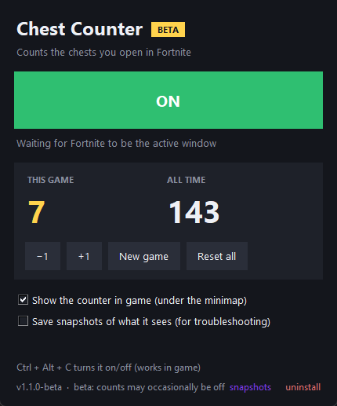

# Chest Counter · Beta

Counts the chests you open in Fortnite. A small overlay under your minimap shows **This game** and **All time**, and the numbers roll up each time you open one.

> **Beta:** Chest Counter is still in beta. It has been tested on 1080p and works well, but a count may occasionally be missed or doubled. Use **+1 / −1** to fix it, and please [open an issue](../../issues) if something looks wrong.



## Download
Get **ChestCounter.exe** from the [latest release](../../releases/latest) and double-click it. You don't need to install anything.

> Windows may say **"Windows protected your PC"** because the app isn't code-signed. Click **More info → Run anyway**.

## How to use
1. Open Chest Counter. It starts **ON** (the green button).
2. Play Fortnite. Every chest you open adds 1. **CHEST X2** adds 2.
3. **This game** goes back to 0 by itself when you get on the Battle Bus. **All time** keeps counting.

| | |
|---|---|
| **Ctrl + Alt + C** | turn it on or off, even in game |
| **+1 / −1** | fix a count by hand |
| **New game** | set *This game* to 0 |
| **Reset all** | set both counts to 0 |

It counts **CHEST**, **CHEST X2**, **RARE CHEST** and **SPRITE CHEST**.

## ⚠️ Turn it off for tournaments
Don't run Chest Counter in **tournaments, FNCS or cash cups**. Press **Ctrl + Alt + C** to turn it off first.

- **Tournaments:** Epic's [FNCS rules (section 8.2.1)](https://www.fortnite.com/competitive/rules-guidelines/rules-library/fortnite-championship-series-fncs-2026-official-rules) ban overlays and tools that read the live game, including through screen recording or screenshots, when they give a competitive advantage. A chest count doesn't give you an edge, but Epic reads this rule broadly and has disqualified players for screen-reading tools. Don't risk it.
- **Normal games:** the [Fortnite EULA](https://legal.epicgames.com/en-US/fortnite/eula) only bans unauthorized software used *to gain an advantage*. Chest Counter doesn't give you one, and it doesn't touch the game. Still, Epic doesn't officially support any third-party app, so you use it at your own risk.

## Uninstall
Click **uninstall** at the bottom of the Chest Counter window and confirm. It deletes your counts, settings and snapshots (`%APPDATA%\ChestCounter`), then removes `ChestCounter.exe` a moment after it closes. Nothing else is left on your PC.

You can also run `ChestCounter.exe --uninstall` with the app closed.

## How it works
When you open a chest, Fortnite shows a purple popup: **"+600 XP · CHEST"**. Chest Counter looks at that one small spot on the screen (280×140 pixels) every 0.6 seconds and recognises the word by its purple outline. Because it only looks at the outline, whatever is behind the popup doesn't matter.

- **It only reads the screen**, like a recording app does. It never touches the game's memory, files or network traffic, and it never presses keys.
- **It's light.** It only looks while Fortnite is the active window, and it runs at below-normal priority with no GPU use. It uses about 50 MB of RAM.
- **Nothing leaves your PC.** Counts and settings are saved in `%APPDATA%\ChestCounter`.

## If it doesn't count
- **Display mode:** use **Windowed Fullscreen** in Fortnite's display settings. Some exclusive-fullscreen setups give screen-capture tools a black screen.
- **HUD scale:** keep it at **100%**. Any 16:9 resolution works, and so does ultrawide.
- **Match score:** while a chest popup is on screen, the number in the app should be **0.70** or higher.
- **Snapshots:** tick **Save snapshots of what it sees**, open some chests, then click **snapshots** in the bottom corner to see exactly what it captured. Attach those to an issue if something's off.

## Run from source
```bash
pip install -r requirements.txt
python chest_counter.py
```
To build the .exe, run `build.bat`. It needs PyInstaller, and the output lands in `dist\ChestCounter.exe`.

To test it against your own screenshots or clip frames:
```bash
python chest_counter.py --test screenshot1.png screenshot2.png
python chest_counter.py --count 20 frame_001.png frame_002.png ...
```

---
Not affiliated with or endorsed by Epic Games. Fortnite is a trademark of Epic Games, Inc.
